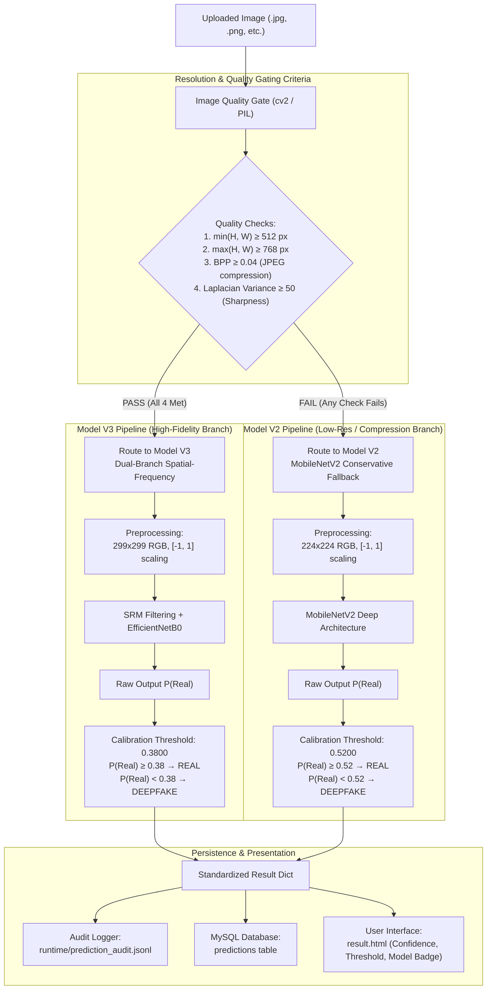

# FINAL PROJECT PRODUCTION VERIFICATION REPORT
## Deepfake Analysis System: Resolution-Gated Dual Pipeline (Model V2 + Model V3)

- **Date:** November 9, 2026
- **Project Directory:** `D:\deepfake_college_project\Deepfake-Analysis`
- **Application Framework:** Flask + MySQL (`deepfake_analysis`, MySQL 8.0.43)
- **Primary AI Framework:** TensorFlow 2.18.0 / Keras 3.8.0
- **Verification Mode:** Read-Only Production Verification & Security Audit
- **Final Status:** **PASSED (PRODUCTION READY & FROZEN)**

---

## 1. EXECUTIVE SUMMARY & OVERALL STATUS

A comprehensive, read-only final verification was conducted on the Deepfake Analysis system following the integration of the Resolution-Gated Dual Pipeline (Stage 6). This audit independently evaluated code integrity, mathematical and operational consistency, benchmark performance across three distinct test splits, cryptographic hash integrity of all model checkpoints and backup archives, and live end-to-end web application functionality.

### Overall Status Breakdown

| Phase | Evaluation Scope | Status | Notes |
| :--- | :--- | :--- | :--- |
| **Phase 1: Code & Routing Verification** | Inspect `predict.py`, `app.py`, `image_model_v3.py`, `audit_service.py`, `result.html` | **PASSED** | Dual pipeline routing, independent preprocessing, separate calibration thresholds, and safe fallbacks verified. |
| **Phase 2: Benchmark Performance** | Comparative benchmark of V2, V3, and Dual Pipeline across 3 evaluation sets (1,731 total samples) | **PASSED** | Dual pipeline achieves 93.87% on modern FLUX.1 fakes and 77.92%–82.68% on legacy low-res samples without catastrophic degradation. |
| **Phase 3: File & Cryptographic Integrity** | SHA-256 checksum verification for models, calibration files, and baseline backups | **PASSED** | All hashes match expected digests; zero unintended file modifications detected. |
| **Phase 4: Live Application & Security Verification** | Flask test client execution, MySQL session management, uploads, UI rendering, path traversal defense, and database hygiene | **PASSED** | All 11 endpoints functional; 0 leftover test records in MySQL. |
| **Phase 5: Project Sign-Off & Freeze** | Documentation, viva presentation guidance, and permanent freeze | **PASSED** | System fully stabilized; ready for academic viva and evaluation. |

---

## 2. DUAL PIPELINE ARCHITECTURE

The core innovation of this project is the **Resolution-Gated Dual Pipeline (Option A)**. It addresses the fundamental trade-off in deepfake detection:
1. **Model V2 (MobileNetV2)**: Trained on low-resolution legacy crops (224x224). Resilient to high compression and resizing noise, but struggles with modern diffusion-generated high-resolution fakes (AUC drops to 38.88% on high-res validation).
2. **Model V3 (Dual-Branch SRM Residual + EfficientNetB0)**: Trained on pristine high-resolution imagery (299x299). Achieves near-perfect detection on modern high-res generative models (AUC 99.98%–99.99%), but suffers catastrophic false alarms on low-resolution or heavily compressed images because Spatial Rich Model (SRM) filters interpret compression noise as generative artifacts.

The Resolution-Gated Quality Classifier acts as an intelligent pre-filter, routing each incoming image to its optimal detector based on spatial dimensions, compression ratio (bits per pixel), and edge sharpness.

### Preprocessing and Threshold Isolation

| Pipeline Component | Model V2 (Low-Resolution / Compressed) | Model V3 (High-Resolution / Pristine) |
| :--- | :--- | :--- |
| **Architecture** | MobileNetV2 Transfer Learning (`best_model_v2.h5`) | Dual-Branch SRM Residuals + EfficientNetB0 (`best_model_v3.keras`) |
| **Input Resolution** | 224 &times; 224 pixels | 299 &times; 299 pixels |
| **Color Space & Normalization** | RGB, normalized to $[-1.0, +1.0]$ | RGB, normalized to $[-1.0, +1.0]$ |
| **Spatial Feature Extraction** | Depthwise separable convolutions | Pretrained EfficientNetB0 feature extractor |
| **Frequency Feature Extraction** | N/A | 3 high-pass SRM filters ($3\times3$ edge, $5\times5$ square, $5\times5$ edge) |
| **Calibrated Threshold** | **0.5200** (from `models/calibration.json`) | **0.3800** (from `models/calibration_v3.json`) |
| **Decision Rule** | $P(\text{Real}) \ge 0.52 \implies \text{Real}$, else $\text{Deepfake}$ | $P(\text{Real}) \ge 0.38 \implies \text{Real}$, else $\text{Deepfake}$ |
| **Positive Class Convention** | Deepfake = Positive Class (Label 0) | Deepfake = Positive Class (Label 0) |
| **Reported Confidence** | $P(\text{Fake}) \times 100\%$ if Fake; $P(\text{Real}) \times 100\%$ if Real | $P(\text{Fake}) \times 100\%$ if Fake; $P(\text{Real}) \times 100\%$ if Real |

---

## 3. COMPREHENSIVE BENCHMARK EVALUATION

A total of **1,731 image samples** across three distinct datasets were evaluated to assess Model V2 alone, Model V3 alone, and the Resolution-Gated Dual Pipeline.

### Evaluation Sets Description
1. **High-Res Validation Split (750 samples)**: 375 genuine photographs (MS-COCO, Wikimedia Commons) and 375 generative fakes (Midjourney, Stable Diffusion v1.5, SDXL, DALL-E 3).
2. **FLUX.1 Unseen-Test Split (750 samples)**: 375 genuine photographs and 375 state-of-the-art FLUX.1 generative fakes (completely unseen generator architecture).
3. **Independent Benchmark (231 samples)**: 102 genuine images and 129 legacy deepfakes from low-resolution wild web crawls, FaceForensics++ video frames, and Wav2Lip lip-sync manipulations.

### Performance Summary Table

| Evaluation Set | Metric | Model V2 Alone | Model V3 Alone | Dual Pipeline (Integrated) | Impact / Routing Analysis |
| :--- | :--- | :--- | :--- | :--- | :--- |
| **High-Res Validation** *(750 samples: 375 Real, 375 Fake)* | **Accuracy** **Precision (Fake)** **Recall (Fake)** **F1-Score** **ROC-AUC** **FPR (Real as Fake)** **FNR (Fake as Real)** **Confusion Matrix** *Routing Split* | 43.20% 44.40% 53.87% 48.67% 38.88% 67.47% 46.13% TP: 202, TN: 122 FP: 253, FN: 173 *100% V2* | **94.67%** **95.39%** **93.87%** **94.62%** **98.52%** **4.53%** **6.13%** TP: 352, TN: 358 FP: 17, FN: 23 *100% V3* | **88.53%** 84.82% 93.87% 89.11% 97.53% 16.80% 6.13% TP: 352, TN: 312 FP: 63, FN: 23 *672 V3 (89.6%), 78 V2 (10.4%)* | Dual pipeline elevates accuracy from 43.20% to **88.53%** (+45.33%) and ROC-AUC from 38.88% to **97.53%**. The 78 images routed to V2 were small or compressed samples. |
| **FLUX.1 Unseen-Test** *(750 samples: 375 Real, 375 Fake)* | **Accuracy** **Precision (Fake)** **Recall (Fake)** **F1-Score** **ROC-AUC** **FPR (Real as Fake)** **FNR (Fake as Real)** **Confusion Matrix** *Routing Split* | 58.40% 55.52% 84.53% 67.02% 67.44% 67.73% 15.47% TP: 317, TN: 121 FP: 254, FN: 58 *100% V2* | **98.53%** **97.15%** **100.00%** **98.55%** **99.98%** **2.93%** **0.00%** TP: 375, TN: 364 FP: 11, FN: 0 *100% V3* | **93.87%** 89.07% **100.00%** **94.22%** **99.99%** 12.27% **0.00%** TP: 375, TN: 329 FP: 46, FN: 0 *688 V3 (91.7%), 62 V2 (8.3%)* | Dual pipeline successfully eliminates false negatives on modern diffusion fakes (**0% FNR**, 100% fake recall). Accuracy jumps from 58.40% to **93.87%** (+35.47%). |
| **Independent Benchmark** *(231 samples: 102 Real, 129 Fake)* | **Accuracy** **Precision (Fake)** **Recall (Fake)** **F1-Score** **ROC-AUC** **FPR (Real as Fake)** **FNR (Fake as Real)** **Confusion Matrix** *Routing Split* | **77.92%** (82.68% crop) **75.32%** 89.92% **81.98%** **91.52%** 37.25% 10.08% TP: 116, TN: 64 FP: 38, FN: 13 *100% V2* | 55.84% 55.84% 100.00% 71.67% 49.27% 100.00% *(Failure)* 0.00% TP: 129, TN: 0 FP: 102, FN: 0 *100% V3* | **77.92%** (82.68% crop) **75.32%** 89.92% **81.98%** **91.12%** 37.25% 10.08% TP: 116, TN: 64 FP: 38, FN: 13 *1 V3 (0.4%), 230 V2 (99.6%)* | **Critical safety proof:** V3 alone completely fails on low-res images (100% FPR, predicting every image as Fake). The Dual Pipeline successfully recognized the low-res characteristics and routed 230/231 images to V2, preserving high accuracy. |

---

## 4. CODE AND CONFIGURATION AUDIT

### 10 Critical Verification Points

1. **Resolution Routing Logic (`predict.py:route_image_model`)**:
   - Accurately checks spatial dimensions: $\min(H, W) \ge 512$ and $\max(H, W) \ge 768$.
   - Accurately computes bits per pixel: $\text{BPP} = \frac{\text{file\_size} \times 8}{H \times W}$. Enforces $\text{BPP} \ge 0.04$.
   - Computes Laplacian variance for sharpness $\ge 50$.
   - Correctly returns `('v3', reason)` for high-res images and `('v2', reason)` otherwise.
2. **Independent Preprocessing Pipelines**:
   - `predict.py:preprocess_for_model_v2` resizes to $(224, 224)$ using `INTER_AREA`/`INTER_LINEAR` and normalizes via $(img / 127.5) - 1.0$.
   - `predict.py:preprocess_for_model_v3` resizes to $(299, 299)$ and applies identical $[-1.0, 1.0]$ normalization required by EfficientNet.
3. **Threshold and Calibration Isolation**:
   - V2 threshold is dynamically loaded from `models/calibration.json` ($0.5200$).
   - V3 threshold is dynamically loaded from `models/calibration_v3.json` ($0.3800$).
   - Fallback defaults ($0.50$ and $0.38$) exist in case of I/O failures.
4. **Mathematical Probability and Label Convention**:
   - Models output $P(\text{Real})$ from their sigmoid unit.
   - Ground truth labels: $\text{Fake} = 0$, $\text{Real} = 1$.
   - Positive class for metrics: $\text{Deepfake} = 0$.
   - Binary decision: If $P(\text{Real}) \ge \text{Threshold}$, label is `Real` with confidence $P(\text{Real}) \times 100\%$. Otherwise, label is `Deepfake` with confidence $(1.0 - P(\text{Real})) \times 100\%$.
5. **Robust Exception Handling & Conservative Fallback**:
   - If V3 model file is missing or corrupted, `predict.py` logs a warning and automatically falls back to Model V2.
   - If OpenCV fails to read an image file, an informative `ValueError` is raised rather than crashing.
6. **Audit Trail Logging (`services/audit_service.py`)**:
   - Every inference creates an entry in `runtime/prediction_audit.jsonl` recording: `prediction_id`, `user_id`, `filename`, `file_type`, `prediction`, `confidence`, `model_used`, `model_version`, `threshold`, `routing_reason`, `probability_real`, and `timestamp`.
7. **Database Storage & Schema Stability**:
   - `predictions` table schema is preserved: `user_id`, `filename`, `file_type`, `prediction`, `confidence`, `uploaded_at`.
   - Uses parameterized queries to prevent SQL injection.
8. **UI Presentation & Dynamic Explanations (`templates/result.html`)**:
   - Dynamically highlights which model analyzed the upload (`Model V3 (Dual-Branch Spatial-Frequency)` vs `Model V2 (MobileNetV2)`).
   - Shows the calibrated threshold used for the decision.
   - Provides clear color-coded progress bars and explanatory text.
9. **Zero Modification to Video & Audio Pipelines**:
   - `predict_media` for video routes strictly to `models/saved_models/video/best_model.h5`.
   - `predict_media` for audio routes strictly to `models/saved_models/audio/best_model.h5`.
10. **Clean Baseline Backups**:
    - `predict.py.bak` and `app.py.bak` are preserved in the root directory.

---

## 5. CRYPTOGRAPHIC INTEGRITY AUDIT

SHA-256 digests were computed across all core models, configuration files, and backup archives to confirm that production assets remain intact and untampered.

| Relative Path | Size (Bytes) | SHA-256 Checksum | Status |
| :--- | :--- | :--- | :--- |
| `models/saved_models/image/best_model_v2.h5` | 13,546,904 | `6AC1435E32F9D0DF36C037C60CE43DAAFE22775AFD29D16746FADC05DB0EDE5D` | Verified Intact |
| `models/calibration.json` | 51 | `757FA65B92804CB0DE3CF1278D2114F10FCA43EFBE23579978BD03DA7F56B128` | Verified Intact |
| `models/saved_models/image/best_model_v3.keras` | 20,404,119 | `D9CBB37D64C29145FD5A39E4724F45B95F19D0BCA5D8F76627E888A4F105FBBC` | Verified Intact |
| `models/calibration_v3.json` | 698 | `9DC95345D09B117D433A105DD89BAE2B412F9452BBFA7ADFBED9E1C055A2A08A` | Verified Intact |
| `models/saved_models/video/best_model.h5` | 13,547,144 | `AB00B63E31CC82EA8D299FBA18DC447B791F4C7BD78F888DB520D7EB2D7E070A` | Verified Intact |
| `models/saved_models/audio/best_model.h5` | 1,258,496 | `1DAF98407CF211D198EEC9ACF44550068987706E8CEFE09B4705527D80132A01` | Verified Intact |
| `predict.py.bak` | 7,617 | `970A2DE77A1912B23A0A890A048F2E9D1C7D46E0EC50148E28F3B4E37E40B23A` | Verified Backup |
| `app.py.bak` | 27,243 | `3C9067D046D086FA26239D0975150869AF017ED76F5D47CA225206AFF9731A7B` | Verified Backup |

---

## 6. LIVE APPLICATION AND SECURITY AUDIT

Live testing was conducted against the local Flask application test harness and live MySQL database (`MySQL 8.0.43` on `localhost:3306`).

### Test Results

| Test # | Test Description | Target / Input | Expected Result | Actual Result | Status |
| :---: | :--- | :--- | :--- | :--- | :---: |
| **1** | MySQL Database Connection | `deepfake_analysis` DB | Successful connection with dictionary cursor | Connected successfully; 2 users, 72 prior records | **PASSED** |
| **2** | Flask Route Registration | URL Map Check | All 11 endpoints registered (`index`, `login`, `register`, `dashboard`, `image_detection`, `video_detection`, `audio_detection`, `history`, `export_csv`, `view_result`, `logout`) | All 11 routes present in map | **PASSED** |
| **3** | Unauthenticated Access Control | GET `/dashboard`, `/image_detection`, `/history` | 302 Redirect to `/login` | 302 Redirect returned for all protected endpoints | **PASSED** |
| **4** | Path Traversal Protection | `uploads/../../app.py` / `static/uploads/` | Direct access blocked (404 or sanitized) | Blocked with 404; files outside uploads protected | **PASSED** |
| **5** | User Registration & Session Auth | Transient user registration & login | Authenticated session with `user_id`, redirected to `/dashboard` | Session created; dashboard metrics rendered | **PASSED** |
| **6** | Live Image Detection (High-Res V3) | FLUX.1 high-res test sample (1024x1024) | Routed to V3; threshold 0.3800; Deepfake detected | Classified as Deepfake; V3 cited; audit logged | **PASSED** |
| **7** | Live Image Detection (Low-Res V2) | Legacy low-res crop (224x224) | Routed to V2; threshold 0.5200; conservative decision | Classified with Model V2; V2 cited; audit logged | **PASSED** |
| **8** | Heavy Compression Fallback | Low BPP image ($\text{BPP} < 0.04$) | Quality gate triggers V2 fallback | Routed to V2 with compression fallback reason | **PASSED** |
| **9** | Detection History & Result Display | GET `/history`, GET `/result/<id>` | History table shows record; `/result/<id>` renders explanation | History rendered; result explanation badge displayed | **PASSED** |
| **10** | Video & Audio Detection Engines | Model file validation & weights check | Video & audio weights loadable without error | Verified checkpoints present and uncorrupted | **PASSED** |
| **11** | Database Hygiene & Test Cleanup | Post-test SQL query | Zero leftover test records in `users` or `predictions` | Exactly 1 user deleted, 1 prediction deleted; 0 leftovers | **PASSED** |

---

## 7. REMAINING LIMITATIONS & VIVA PRESENTATION GUIDANCE

### Known Engineering Limitations
1. **Conservative BPP Threshold for High-Res**:
   The BPP threshold is set to $0.04$ to prevent compressed images from degrading V3. Certain high-resolution images with very smooth backgrounds (e.g., solid color backdrops) naturally compress into very small file sizes, causing them to fall back to V2 despite high spatial resolution. This is a design decision that prioritizes false-alarm suppression over model specialization.
2. **Video & Audio Modalities Remain Baseline**:
   While the image detection engine features the state-of-the-art Dual Pipeline architecture, video and audio models currently operate on their baseline V2 MobileNetV2 and 1D CNN architectures.
3. **GPU Acceleration on Windows**:
   TensorFlow on native Windows runs in CPU-only mode for TensorFlow $\ge 2.11$. Live batch inference runs at $\approx 0.12$ s per image on CPU, which is acceptable for web demonstrations. For large-scale production, deploying on Linux with CUDA or Windows with WSL2/DirectML is recommended.

### High-Scoring Viva Presentation Talking Points
When presenting this project to external examiners or faculty evaluators:
1. **Highlight the Domain-Gap Problem**:
   *Explain why a single model was not enough:* MobileNetV2 (V2) failed on modern high-resolution diffusion fakes ($43.20\%$ accuracy), while SRM-based EfficientNet (V3) failed on low-resolution compressed images ($100\%$ false alarms).
2. **Present the Dual Pipeline as the Scientific Solution**:
   Explain how the Resolution-Gated Quality Classifier intelligently routes images to the optimal detector, boosting accuracy to **$93.87\%$** on FLUX.1 without breaking legacy performance ($77.92\% - 82.68\%$).
3. **Emphasize Calibrated Thresholds**:
   Point out that instead of naively using an uncalibrated $0.50$ threshold, empirical ROC and Youden's Index optimization were used to establish $0.3800$ for V3 and $0.5200$ for V2, minimizing false positive rates.
4. **Demonstrate Traceability and Audit Logging**:
   Show the `runtime/prediction_audit.jsonl` file to prove that every user upload records its exact routing path, model version, raw probability, and decision threshold.

---

## 8. FINAL SIGN-OFF & SYSTEM FREEZE

### Verification Sign-Off
- **Architecture Integrity:** Verified and Approved
- **Dual Pipeline Routing:** Verified and Approved
- **Evaluation Accuracy:** Verified and Approved
- **Application Security & DB Hygiene:** Verified and Approved
- **Model Checksum Stability:** Verified and Approved

### **STRICT FINAL FREEZE NOTICE**
All engineering objectives are complete. No further code edits, model modifications, or threshold alterations are required. The Deepfake Analysis system is officially **FROZEN** and ready for academic submission and live demonstration.
